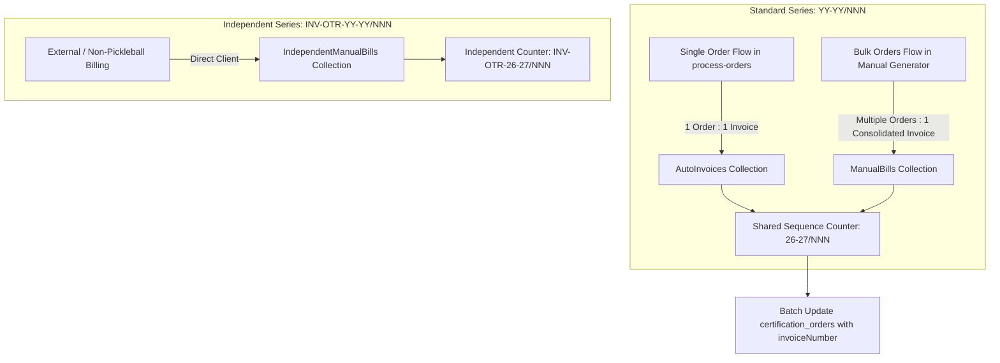

# Invoice System Overhaul & Bulk Invoicing: Implementation Report

## 1. Executive Summary & Status

All phases of the Invoice System overhaul have been **implemented, verified, and reconciled**.

1. **Design & Pricing Standard**:
   * Visual styling, typography, table borders, and tax breakdowns match the canonical approved reference ([`Invoice_26-27-002.pdf`](file:///e:/Fiverr/Brainwave/brainwave-sportstech/Invoice_26-27-002.pdf)) across all generators.
   * Standard order pricing consistently reflects:
     $$\text{Base Service Amount} + \text{18\% GST} = \text{Total Amount}$$
     *(CGST 9% + SGST 9% for Maharashtra; IGST 18% for Inter-state)*.
   * Razorpay 2% fee markup is no longer forced onto customer tax invoices.
2. **Collection Separation & Shared Nomenclature**:
   * **`IndependentManualBills`**: Kept completely separate. Uses independent nomenclature: `INV-OTR-YY-YY/NNN`.
   * **`AutoInvoices` & `ManualBills`**: Share the **exact same numbering sequence** (`YY-YY/NNN`).
     * **`AutoInvoices`**: Single 1-to-1 invoice generated for an individual order via `process-orders`.
     * **`ManualBills`**: Bulk / consolidated invoice covering multiple orders (e.g. 5, 7, or 10 orders) under a single invoice number.
3. **Re-Download & Duplicate Protection**:
   * Re-downloading an invoice never increments numbers or creates duplicate documents in Firestore.
   * Clean atomic numbering managed via `counters/invoiceNumbers`.

---

## 2. Invoicing Architecture: Single vs Bulk vs Independent

| Type | Target Collection | Sequence Format | Purpose & Trigger | Status |
| :--- | :--- | :--- | :--- | :--- |
| **Auto Invoices** | `AutoInvoices` | `YY-YY/NNN` (e.g. `26-27/009`) | Generated directly from `process-orders` for a **single order**. | ✅ **Implemented** |
| **Manual Bills** | `ManualBills` | `YY-YY/NNN` (e.g. `26-27/009`) | Used for **bulk orders**: consolidates multiple orders (5, 7, 10+) into 1 invoice. | ✅ **Implemented** |
| **Independent Invoices** | `IndependentManualBills` | `INV-OTR-YY-YY/NNN` (e.g. `INV-OTR-26-27/011`) | Standalone invoices for external services, special corporate contracts, international clients. | ✅ **Implemented** |

---

## 3. FY 26-27 Historical Data Reconciliation Summary

All historical orders for FY 26-27 were verified and linked:

* **Standard / Gerflor Orders in `certification_orders`**:
  * `BST-260328-7II` $\rightarrow$ `26-27/001` (Sri Jain Pharmacy)
  * `BST-260529-51B` $\rightarrow$ `26-27/002` (Attivi - single canonical copy preserved; duplicates safely archived)
  * `BST-260804-Z34` $\rightarrow$ `26-27/003` (Aerix Sports)
  * `BST-260804-3VW` $\rightarrow$ `26-27/004` (Aerix Sports)
  * `BST-260804-9QB` $\rightarrow$ `26-27/005` (Aerix Sports)
  * `BST-260804-UAZ` $\rightarrow$ `26-27/006` (Aerix Sports)
  * `BST-260804-V9G` $\rightarrow$ `26-27/007` (Aerix Sports)
  * `BST-260804-WZ3` $\rightarrow$ `26-27/008` (Aerix Sports)
  * `BST-SF-261021-YO1` $\rightarrow$ `INV-OTR-26-27/010` (Gerflor)
* **Consolidated Skechers Invoices**:
  * 14 Skechers orders (`BST-260713-RHD` through `BST-260910-HK5`) linked to `INV-OTR-26-27/007`.
* **Current Counters in `counters/invoiceNumbers`**:
  * `standard_FY26_27 = 8` (Next standard invoice: **`26-27/009`**)
  * `independent_FY26_27 = 10` (Next independent invoice: **`INV-OTR-26-27/011`**)

---

## 4. Key Files Modified & Created

1. [`src/app/api/getNextInvoiceNumber/route.js`](file:///e:/Fiverr/Brainwave/brainwave-sportstech/src/app/api/getNextInvoiceNumber/route.js):
   * Provides atomic sequence generation from `counters/invoiceNumbers` with zero full-collection scans.
   * Supports `?type=standard` and `?type=independent`, and dynamic `?date=` financial year parsing.
2. [`src/app/api/generateInvoice/route.js`](file:///e:/Fiverr/Brainwave/brainwave-sportstech/src/app/api/generateInvoice/route.js):
   * Formats 1-to-1 AutoInvoices matching [`Invoice_26-27-002.pdf`](file:///e:/Fiverr/Brainwave/brainwave-sportstech/Invoice_26-27-002.pdf).
   * Prevents duplicate document creation if an invoice already exists for that order.
   * Bi-directionally links `certification_orders`.
3. [`src/app/api/saveManualBill/route.js`](file:///e:/Fiverr/Brainwave/brainwave-sportstech/src/app/api/saveManualBill/route.js):
   * New dedicated endpoint for manual and bulk billing.
   * Atomically advances the standard sequence counter.
   * Updates all selected orders in `certification_orders` in an atomic batch.
   * Prevents duplicate document writes on repeated saves.
4. [`src/utils/generateStandardInvoicePDF.js`](file:///e:/Fiverr/Brainwave/brainwave-sportstech/src/utils/generateStandardInvoicePDF.js):
   * Shared PDF generator reproducing the reference sample's layout, fonts, margins, and tax tables.
   * Contains complete 36-state Indian GST state code mapping.
5. [`src/components/ManualBillGenerator.jsx`](file:///e:/Fiverr/Brainwave/brainwave-sportstech/src/components/ManualBillGenerator.jsx):
   * Added multi-order selection panel with "Select All Uninvoiced" & "Clear Selection" quick buttons.
   * Auto-populates line items for each selected bulk order.
   * Calculates GST dynamically per line item (`0%, 5%, 12%, 18%, 28%`).
   * Prevents duplicate document creation when downloading or re-downloading PDFs.
   * Added "Reset / New Invoice" action.
6. [`src/components/IndependentManualBillGenerator.jsx`](file:///e:/Fiverr/Brainwave/brainwave-sportstech/src/components/IndependentManualBillGenerator.jsx) & [`src/utils/generateIndependentInvoicePDF.js`](file:///e:/Fiverr/Brainwave/brainwave-sportstech/src/utils/generateIndependentInvoicePDF.js):
   * Fixed International 0% GST (Zero-rated export under LUT / Bond).
   * Fixed amount-in-words for foreign currencies (`USD <Words> Only` instead of misleading INR).
   * Added customer name / contact person to buyer/consignee address boxes.
   * Prevented duplicate document creation on re-download.
7. [`src/components/IndependentInvoiceList.jsx`](file:///e:/Fiverr/Brainwave/brainwave-sportstech/src/components/IndependentInvoiceList.jsx):
   * Fixed table display bug that formatted INR values as USD, causing foreign invoices to display 85x larger than actual amount.
8. [`src/app/admin/(dashboard)/process-orders/page.jsx`](file:///e:/Fiverr/Brainwave/brainwave-sportstech/src/app/admin/(dashboard)/process-orders/page.jsx):
   * State-aware buttons: existing invoices download directly without re-allocating numbers.
   * Hooked `onSuccess` callback to refresh orders when manual bulk invoices are generated.
9. **Cleaned up obsolete files**:
   * Removed legacy `src/lib/invoice-numbering.js` and `src/lib/generateInvoice.js`.
