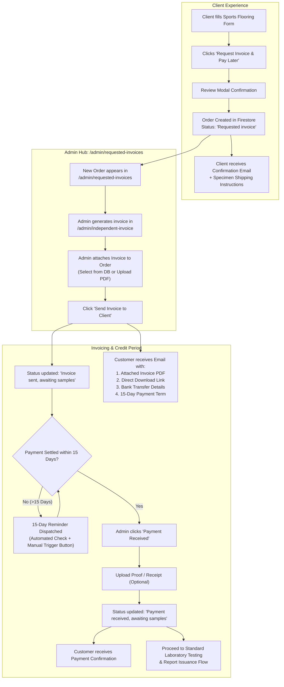

# Implementation Plan: Request Invoice & Pay Later Workflow

This document outlines the end-to-end architecture, technical specifications, and implementation roadmap for the **"Request Invoice & Pay Later"** capability in the Brainwave SportsTech platform.

---

## 1. Executive Summary & Problem Context

In commercial sports flooring certification and high-value technical testing, institutional clients and large infrastructure developers frequently require official corporate tax invoices prior to disbursing funds. Their operational cycle involves:
1. Submitting technical specifications and physical flooring test specimens.
2. Requesting a formal tax invoice with credit payment terms (typically 15 days).
3. Reviewing and processing invoice payment through corporate finance workflows while the laboratory inspects/prepares the specimens.
4. Requiring fee clearance within 15 days before the final certification evaluation report is formally released.

Currently, this workflow is handled manually via offline channels. This implementation automates the submission, tracking, invoice dispatch, automated payment countdown reminders, and payment reconciliation.

---

## 2. End-to-End Workflow Architecture



---

## 3. Order Status Lifecycle

| Step | Status Name | Description | Next Trigger |
| :--- | :--- | :--- | :--- |
| **1** | `Requested invoice` | Order placed via "Request Invoice & Pay Later". Awaiting invoice generation & specimen shipment. | Admin sends invoice via admin panel |
| **2** | `Invoice sent, awaiting samples` | Official tax invoice sent to client. 15-day payment countdown starts. | Client pays OR 15-day reminder fires |
| **3** | `Payment received, awaiting samples` | Admin confirms receipt of payment. | Test specimens arrive at laboratory |
| **4** | `Samples received, testing in 72 hrs` | Physical specimens delivered to Badlapur laboratory. | Testing starts |
| **5** | `Testing in progress` | Lab engineers executing EN/ASTM/ISO tests. | Testing finishes |
| **6** | `Certification Completed` | Official report & AIPA certificate issued. | Process complete |

> **Note:** If physical specimens arrive at the lab *before* payment is received, the status can transition to `"Samples received, awaiting payment"`, allowing lab staff to prepare specimens while waiting for finance clearance.

---

## 4. Detailed Component Changes

### 4.1. Sports Flooring Application Form
* **Primary File:** `src/app/forms/sports-flooring-certification/application-form/page.jsx`

1. **New Action Button:**
   - Add `"Request Invoice & Pay Later"` to the actions row alongside `"Add to Cart"`, `"Pay Using Razorpay"`, and `"Pay Using Bank Details"`.
   - Button styling: Clean secondary/indigo styling with a document icon.
2. **Conditional Validation:**
   - Upfront payment receipt upload is **not required** when choosing `"invoice"`.
   - Client contact information, sample specifications, flooring image, and terms acceptance remain strictly mandatory.
3. **Review Modal:**
   - Adapts to show `"Confirm Invoice Request"` when `pendingAction === "invoice"`.
4. **Order Creation (`executeRequestInvoiceSubmit`):**
   - Saves order document in Firestore `certification_orders`:
     ```json
     {
       "orderId": "BW-FL-XXXXXXXX",
       "category": "Flooring",
       "paymentType": "Request Invoice",
       "order_status": "Requested invoice",
       "invoiceStatus": "Pending Generation",
       "invoiceRequestedAt": "2026-10-14T...",
       "totalPriceINR": 60000,
       "convertedPriceWithSymbol": "₹ 60,000"
     }
     ```
   - Triggers customer confirmation email notifying them of the successful submission and providing shipping instructions for the 2 specimen tiles (500mm x 500mm).

---

### 4.2. New Admin Page: "Requested Invoices"
* **New Route:** `src/app/admin/(dashboard)/requested-invoices/page.jsx`
* **Navigation Link:** Added to `src/app/admin/(dashboard)/layout.jsx` sidebar.

#### Features & Sections:
1. **Summary Analytics Cards:**
   - **Total Invoice Requests**: All-time requested invoice volume.
   - **Pending Generation**: Orders needing invoice generation and dispatch.
   - **In 15-Day Window**: Invoices sent, waiting for payment within terms.
   - **Overdue Invoices**: Orders where 15 days elapsed without payment.
   - **Settled / Paid**: Orders where payment has been verified.

2. **Interactive Orders Table:**
   - Columns: `Order ID`, `Date`, `Company / Applicant`, `Contact Info`, `Flooring Specs`, `Fee`, `Current Status`, `Invoice Status & Countdown`, `Actions`.
   - Search bar: Filter by Order ID, Company, or Email.
   - Status filters: View All, Pending Invoice, Awaiting Payment, Overdue, Paid.

3. **Action Modal 1 — "Generate / Upload & Send Invoice":**
   - **Option A (Quick Select):** Dropdown to select from existing invoices stored in `IndependentManualBills` collection.
   - **Option B (File Upload):** File upload field for any external/downloaded PDF invoice.
   - **Quick Link:** *"Open Independent Invoice Generator ↗"* (opens `/admin/independent-invoice` in a new tab).
   - **Execution:**
     - Uploads file to Firebase Storage: `invoices/{orderId}_invoice.pdf`.
     - Updates Firestore order:
       - `order_status = "Invoice sent, awaiting samples"`
       - `invoiceStatus = "Invoice Sent"`
       - `invoiceNumber = ...`
       - `invoiceUrl = ...`
       - `invoiceSentAt = serverTimestamp()`
       - `paymentDueDate = timestamp + 15 days`
     - Automatically calls email API to dispatch invoice to the client.

4. **Action Control 2 — "15-Day Reminder Email (Hybrid)":**
   - Visual countdown badge on each row (e.g., *"Day 5 of 15"*, *"⚠️ Overdue by 4 days"*).
   - Manual **"Send Reminder Now"** button with confirmation modal.
   - Displays history: *Last reminder sent on [Date]* and *Reminder count: [N]*.

5. **Action Modal 3 — "Mark Payment Received":**
   - Opens when admin receives bank wire / RTGS / NEFT transfer.
   - Optional file upload for payment proof/receipt screenshot.
   - Optional input for Transaction / UTR Number.
   - Updates order:
     - `order_status = "Payment received, awaiting samples"`
     - `paymentStatus = "Paid"`
     - `paymentReceivedAt = serverTimestamp()`
     - `paymentReceipt = uploadUrl`
   - Sends client payment receipt confirmation email.

---

### 4.3. Backend API Endpoints & Automated Checks

1. **Invoice Dispatch API (`/api/sendInvoiceEmail`):**
   - Receives: `orderId`, `userEmail`, `userName`, `invoiceNumber`, `invoiceUrl`, `totalAmount`, `dueDate`.
   - Sends an official email via Nodemailer containing:
     - The invoice attached as a PDF file.
     - Direct button to view/download invoice online.
     - Official Brainwave bank transfer details (ICICI Bank, IFSC, Account Number).
     - Notice indicating payment is due within 15 calendar days.

2. **Automated Overdue Check & Reminder API (`/api/admin/check-overdue-invoices`):**
   - Queries `certification_orders` where:
     - `order_status === "Invoice sent, awaiting samples"`
     - `invoiceSentAt` is older than 15 days
     - `paymentStatus !== "Paid"`
   - Sends the 15-day overdue notice email.
   - Records `lastReminderSentAt` and `autoReminderSent = true`.
   - Automatically invoked on Requested Invoices page load or via scheduled cron.

3. **Email Templates in `src/utils/emailTemplates.js`:**
   - **`Requested invoice`**: Confirmation of request and sample specimen shipping instructions.
   - **`Invoice sent, awaiting samples`**: Formal delivery of invoice with attached PDF and payment terms.
   - **`15-Day Payment Reminder`**: Overdue reminder notifying the company that payment must be received to issue certified test results.
   - **`Payment Received`**: Official confirmation acknowledging payment clearance.

---

### 4.4. Order Synchronization in Process Orders
* **Primary File:** `src/app/admin/(dashboard)/process-orders/page.jsx`

- Update `getStatusOptions` to include:
  - `"Requested invoice"`
  - `"Invoice sent, awaiting samples"`
- Add status badge color mapping:
  - `Requested invoice`: Amber / Orange (`bg-amber-100 text-amber-800`)
  - `Invoice sent, awaiting samples`: Indigo / Blue (`bg-blue-100 text-blue-800`)
- Ensure orders with `paymentType === "Request Invoice"` display cleanly with full transparency.

---

## 5. Implementation Step-by-Step Checklist

- [ ] **Step 1: Update Application Form**
  - Add "Request Invoice & Pay Later" button to `application-form/page.jsx`.
  - Add `executeRequestInvoiceSubmit` handler and Firestore record logic.
  - Update `ReviewModal` for invoice request flow.

- [ ] **Step 2: Update Email Templates & Send Routes**
  - Add templates for `"Requested invoice"`, `"Invoice sent, awaiting samples"`, and `"15-Day Payment Reminder"` in `emailTemplates.js`.
  - Implement `/api/sendInvoiceEmail` supporting PDF attachments and download links.
  - Implement `/api/admin/check-overdue-invoices` for automated overdue reminder checks.

- [ ] **Step 3: Create Admin Requested Invoices Page**
  - Create new page at `src/app/admin/(dashboard)/requested-invoices/page.jsx`.
  - Add KPI stats, search/filtering, and table layout.
  - Implement "Upload & Send Invoice" modal with both file upload and `IndependentManualBills` selection.
  - Implement manual "Send Reminder" button and "Payment Received" modal.

- [ ] **Step 4: Update Admin Dashboard Layout & Process Orders**
  - Add navigation item in `layout.jsx`.
  - Update `getStatusOptions` in `process-orders/page.jsx`.

- [ ] **Step 5: End-to-End Validation**
  - Test client submission with "Request Invoice & Pay Later".
  - Test admin invoice generation, attachment, and email dispatch with PDF attachment.
  - Test 15-day countdown and reminder trigger.
  - Test marking payment as received with optional receipt upload.
